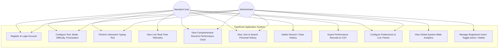
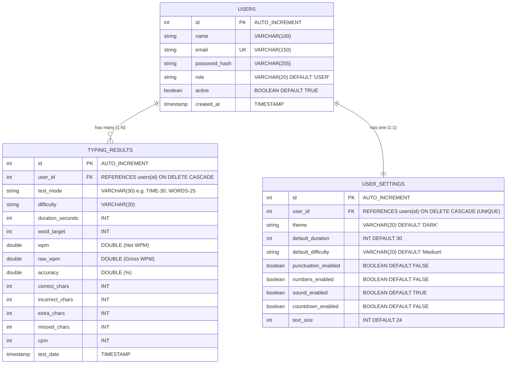
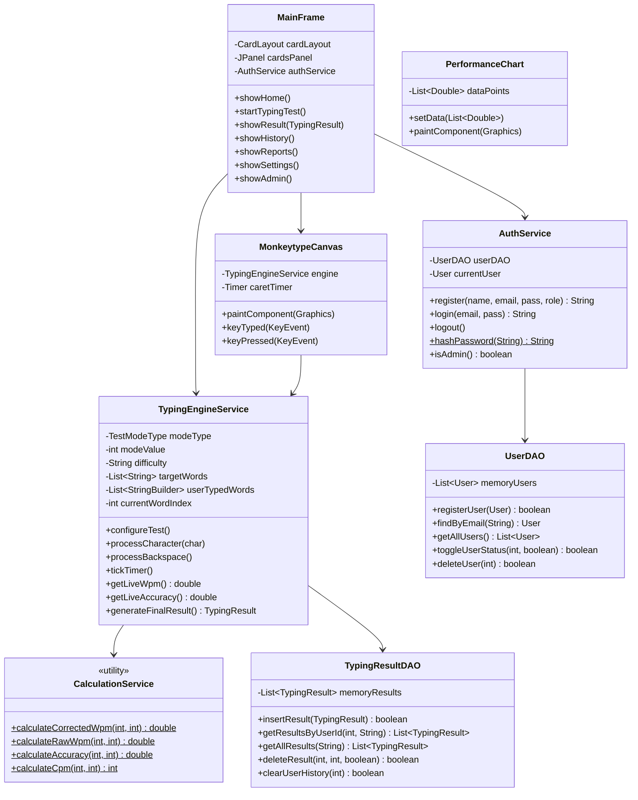
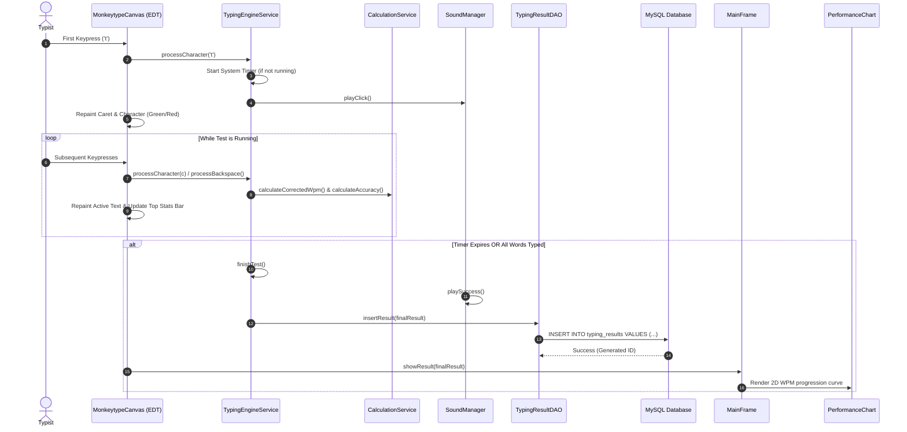

# System Design & UML Diagrams
## TypeRush – Typing Speed Tester

---

## 1. Use Case Diagram

---

## 2. Entity-Relationship (ER) Diagram

---

## 3. High-Level Class Diagram

---

## 4. Sequence Diagram: Typing Test Execution Flow

